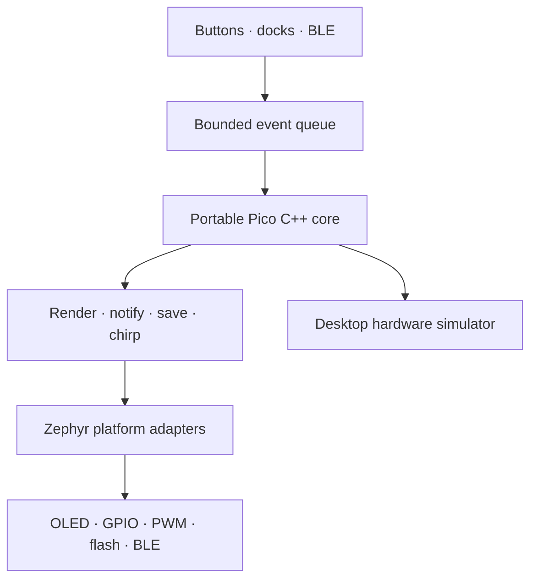

# Pico firmware architecture

## Purpose of this prototype

Version 0.1 proves the seams that nearly every future Pico feature needs:

1. a deterministic personality and mode state machine;
2. local physical interaction;
3. a small monochrome sprite compositor;
4. encrypted BLE control and state updates;
5. persisted personality state and Bluetooth bonds;
6. dock-driven context changes; and
7. non-blocking sound feedback.

The companion, focus, and cooking timer modes have real core behavior. Music,
wayfinding, notes, and driving are registered now so their wire IDs remain
stable, but their specialized behavior is deliberately not faked before the
corresponding input hardware and product rules exist.

## Boundaries

`lib/pico_core` has no Zephyr headers, heap allocation, threads, or hardware
knowledge. It owns the deterministic state machine plus portable display,
protocol, and persistence codecs. The host tests, desktop simulator, and board
firmware compile these same sources. `src/platform` owns the nRF Connect SDK
APIs. `src/main.cpp` is the board orchestration layer.

The event queue is bounded and accepts only an 8-byte plain data event. GPIO
interrupts and Bluetooth callbacks never run personality logic directly. They
enqueue an event and leave the main thread to apply state transitions and
side effects.

## Feature-card model

Each mode has a stable `Mode` value and a `FeatureDescriptor`. Adding a feature
means adding its source file and registering its descriptor; it does not mean
growing one permanent `switch` forever.

The phone may activate, configure, or update data for firmware features over a
versioned protocol. Raw `.cpp` files cannot be copied into a running
microcontroller as executable features. If post-sale executable modules ever
become a real requirement, use signed firmware slots or evaluate Zephyr LLEXT
with strict resource and signature policies. That is a later security and
memory decision, not part of the first breadboard build.

## State ownership

The core owns:

- selected mode and mood;
- current dock and BLE connection state;
- monotonic timer deadlines;
- interaction count; and
- battery percentage when a platform adapter supplies it.

Flash writes are coalesced for five seconds so a run of button presses does not
become one NVS write per interaction. Flash stores only durable personality state. Running timer deadlines are not
persisted because the first prototype has no confirmed real-time clock; a
reboot must never resurrect a timer with invented elapsed time. Car mode is
also not persisted—docking selects it, and undocking restores the prior mode.

## Power posture

There is no polling thread per feature. The main loop blocks on the event queue
with a 20 ms ceiling for the existing debounced button polling. A 100 ms
animation sampler and one-second timer tick share this loop. Zephyr can idle the CPU
between events. Display shutdown policy, slower advertising after a quiet
period, microphone duty cycling, and battery ADC sampling belong in the next
power-measurement pass after the actual board and battery circuit are known.

## Sprint 01 services

`Timer` owns running/paused/remaining/total state and computes elapsed time
from caller-supplied monotonic timestamps, including missed updates and
unsigned clock wrap. It is a reusable instance, not a global per-mode timer.
`Personality` owns seeded scheduling for blinks, idle glances, temporary
reactions and inactivity sleep. `Core` coordinates these services and UI
transitions; `State` exposes snapshots for the renderer and protocol.

`Tick` retains seconds for timers. Appended `AnimationTick` carries milliseconds
for facial motion. The simulator advances the same services with subsecond
steps. Menu/utility screens suppress idle behavior; timer completion overrides
the screen until its temporary alert ends. See `sprint01.md` for controls,
physical acceptance, migration and validation limits.

Source BMPs remain in `bmp-primitives`. A standard-library Python tool compiles
their actual palettes and packed pixels into `face_assets.hpp`. The C++ renderer
blits these primitives using signed clipped coordinates, centering the 128x68
source anchors on the 128x64 panel. Board builds do not need Python asset
conversion or runtime files. Re-run the tool and its `--check` mode after asset
changes. Theme IDs remain stable.

Durable records now use v3 (20 bytes) and include theme and next-timer duration.
The reader migrates v1/v2 records; the platform accepts both lengths. Automatic
personality transitions do not save, and identical OLED frames skip transfer.
Boot enters Companion/Home even if a legacy record saved another user mode.

## Sprint 02: session sequencing and I2S audio

`FocusSession` owns Work/Break phase, confirmation state and per-cycle count.
It does not measure time: Core uses its existing `Timer` instance for every
phase. Completion marks a phase waiting; an explicit event starts the next.
Changing away from Focus cancels a cycle; screen navigation alone preserves it.
These transient values do not expand persistence v3.

`pico::audio` renders deterministic, integer, bounded stereo PCM. The platform
`Audio` adapter queues cue IDs to a sleeping I2S worker backed by a fixed slab;
main stays responsive. Audio is opt-in via Kconfig/devicetree and visual alerts
remain the fallback. No device clock, threads or heap enter the portable core.
Mute clears pending cues; the current bounded cue may finish. See
[sprint02.md](sprint02.md) for wiring, resource limits and validation status.

The optional quieter profile disables diagnostic probes; button handling still
polls every 20 ms. Interrupt-driven wakeups and battery policy remain future
work pending physical power measurements.

## Music metronome

`Metronome` owns rational beat phase and tap-tempo estimation without threads,
allocation or platform clocks. `MusicTick` supplies monotonic milliseconds;
Core routes its state/click effects into the renderer and audio adapter. It
runs independently of the seconds-based Timer. Completion of a timer stops
metronome playback before issuing the alert. Per-beat updates avoid Persist
and Notify, while Start/Stop/settings changes notify.

Music appends a dedicated screen with six local actions and reuses the existing
button mappings. Audio click/accent IDs append after the original cues, and
busy audio drops stale beats. Main enqueues sound before potentially blocking
OLED rendering. Millisecond phase correctness is host-tested; physical jitter
remains unmeasured. Details: [music-metronome.md](music-metronome.md).

## Onboard microphone tuner

`pitch::Detector` owns allocation-free period detection, note/cents conversion,
energy/periodicity/clipping gates and short confirmation/median filtering.
`Microphone` owns regulator/PDM control, a DMA slab and FPU worker, delivering
only compact readings through a latest-result mailbox. Session tokens discard
late results after exit/re-entry. Core owns capture intent and Tuner screen.

Capture is opt-in and active only while listening. Pico sound is temporarily
suppressed to avoid feedback. STOP drains DMA before removing microphone power;
errors clear readiness without preventing Companion/Timer use. Raw samples are
never persisted or sent to the phone. See [music-tuner.md](music-tuner.md) for
sample-clock details, resource budgets and the outstanding hardware checks.

## Motion-aware personality

`motion::Detector` classifies timestamped milli-g samples using integer state
and bounded time windows. The optional `Motion` adapter reads the SDK Sense
accelerometer, owns ODR/error handling, and emits sparse classifier events.
Core filters reactions by screen, mode, dock, active utility, expression
priority, event age and runtime behavior mask. The shared Personality engine
owns the resulting expression timing and rest state.

Motion never starts/advances/cancels a timer, increments pat count, chirps or
writes flash. Rest requires both classifier stillness and user inactivity.
The implementation polls at ~25 Hz inside the existing loop; it does not yet
provide hardware sleep/wakeup. See [motion-personality.md](motion-personality.md)
for timing thresholds, compatibility and physical validation limits.
