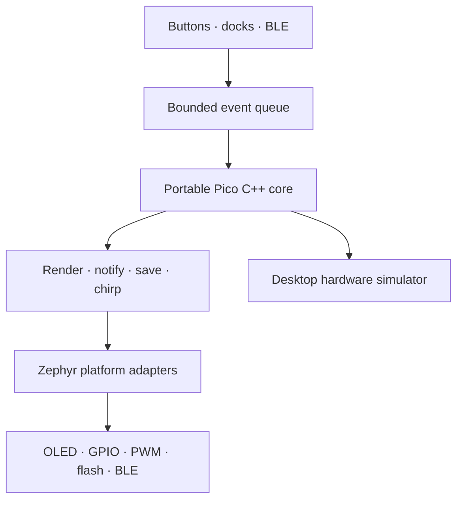

# Pico firmware architecture

## Purpose of this prototype

Version 0.1 proves the seams that nearly every future Pico feature needs:

1. a deterministic personality and mode state machine;
2. local physical interaction;
3. a small monochrome sprite compositor;
4. encrypted BLE control and state updates;
5. persisted personality state and Bluetooth bonds;
6. dock-driven context changes; and
7. non-blocking sound feedback.

The companion and focus modes have real core behavior. Music, cooking,
wayfinding, notes, and driving are registered now so their wire IDs remain
stable, but their specialized behavior is deliberately not faked before the
corresponding input hardware and product rules exist.

## Boundaries

`lib/pico_core` has no Zephyr headers, heap allocation, threads, or hardware
knowledge. It owns the deterministic state machine plus portable display,
protocol, and persistence codecs. The host tests, desktop simulator, and board
firmware compile these same sources. `src/platform` owns the nRF Connect SDK
APIs. `src/main.cpp` is the board orchestration layer.

The event queue is bounded and accepts only an 8-byte plain data event. GPIO
interrupts and Bluetooth callbacks never run personality logic directly. They
enqueue an event and leave the main thread to apply state transitions and
side effects.

## Feature-card model

Each mode has a stable `Mode` value and a `FeatureDescriptor`. Adding a feature
means adding its source file and registering its descriptor; it does not mean
growing one permanent `switch` forever.

The phone may activate, configure, or update data for firmware features over a
versioned protocol. Raw `.cpp` files cannot be copied into a running
microcontroller as executable features. If post-sale executable modules ever
become a real requirement, use signed firmware slots or evaluate Zephyr LLEXT
with strict resource and signature policies. That is a later security and
memory decision, not part of the first breadboard build.

## State ownership

The core owns:

- selected mode and mood;
- current dock and BLE connection state;
- monotonic timer deadlines;
- interaction count; and
- battery percentage when a platform adapter supplies it.

Flash writes are coalesced for five seconds so a run of button presses does not
become one NVS write per interaction. Flash stores only durable personality state. Running timer deadlines are not
persisted because the first prototype has no confirmed real-time clock; a
reboot must never resurrect a timer with invented elapsed time. Car mode is
also not persisted—docking selects it, and undocking restores the prior mode.

## Power posture

There is no polling thread per feature. The main loop blocks on the event queue
and wakes briefly for a one-second monotonic tick. Zephyr can idle the CPU
between events. Display shutdown policy, slower advertising after a quiet
period, microphone duty cycling, and battery ADC sampling belong in the next
power-measurement pass after the actual board and battery circuit are known.
