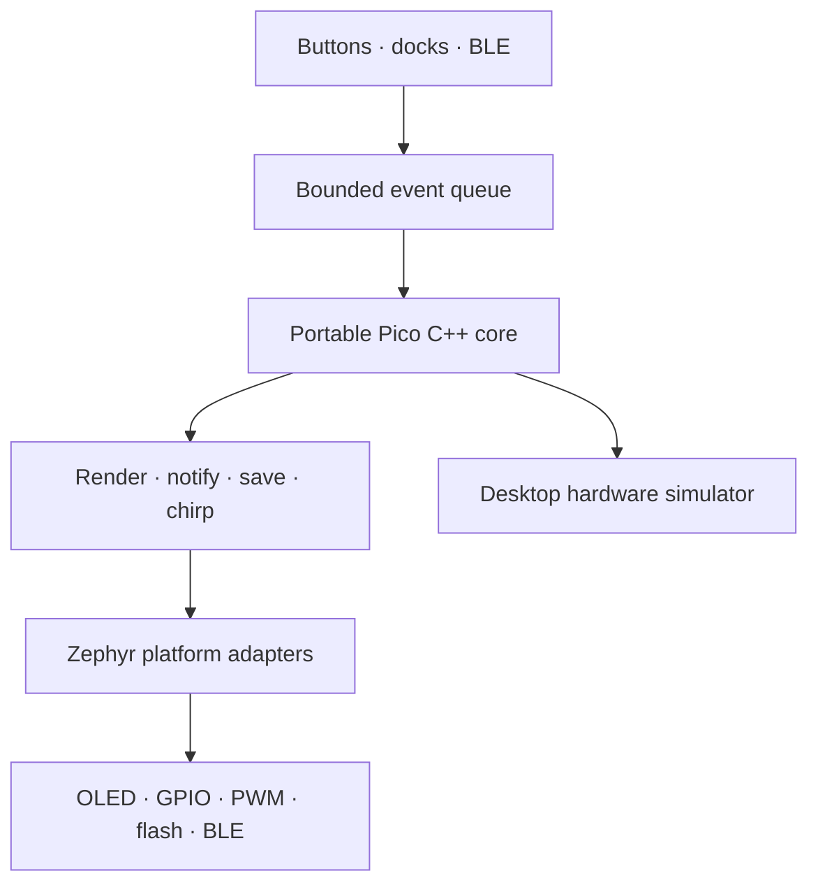

# Pico firmware architecture

**Current source milestone (November 18, 2026):** `0.9.0-oled-power`. Older sprint descriptions below document their original scope; storage v5 and the current feature sections supersede obsolete earlier formats. Current combined-board compilation, electrical timing and battery life remain unverified.

## Purpose of this prototype

The original v0.1 architecture established the seams that later features use:

1. a deterministic personality and mode state machine;
2. local physical interaction;
3. a small monochrome sprite compositor;
4. encrypted BLE control and state updates;
5. persisted personality state and Bluetooth bonds;
6. dock-driven context changes; and
7. non-blocking sound feedback.

Companion, Focus and Cooking timer behavior, the Music metronome and optional
Sense tuner, and guarded Sense motion reactions now have core/platform code.
Driving dock transitions are implemented. Wayfinding and Notes retain stable
mode IDs, without GPS/compass or recording support; home/car dock electronics
are not complete.

## Boundaries

`lib/pico_core` has no Zephyr headers, heap allocation, threads, or hardware
knowledge. It owns the deterministic state machine plus portable display,
protocol, and persistence codecs. The host tests, desktop simulator, and board
firmware compile these same sources. `src/platform` owns the nRF Connect SDK
APIs. `src/main.cpp` is the board orchestration layer.

The event queue is bounded and accepts only an 8-byte plain data event. GPIO
interrupts and Bluetooth callbacks never run personality logic directly. They
enqueue an event and leave the main thread to apply state transitions and
side effects.

## Feature-card model

Each mode has a stable `Mode` value and a `FeatureDescriptor`. Adding a feature
means adding its source file and registering its descriptor; it does not mean
growing one permanent `switch` forever.

The phone may activate, configure, or update data for firmware features over a
versioned protocol. Raw `.cpp` files cannot be copied into a running
microcontroller as executable features. If post-sale executable modules ever
become a real requirement, use signed firmware slots or evaluate Zephyr LLEXT
with strict resource and signature policies. That is a later security and
memory decision, not part of the first breadboard build.

## State ownership

The core owns:

- selected mode and mood;
- current dock and BLE connection state;
- monotonic timer deadlines;
- interaction count; and
- battery percentage when a platform adapter supplies it.

Flash writes are coalesced for five seconds so a run of button presses does not
become one NVS write per interaction. Flash stores confirmed durable personality and user preferences, not active timers or editors. Running timer deadlines are not
persisted because the first prototype has no confirmed real-time clock; a
reboot must never resurrect a timer with invented elapsed time. Car mode is
also not persisted—docking selects it, and undocking restores the prior mode.

## Power posture

There is no polling thread per feature. The main loop blocks on the event queue
until the earliest timer, personality, metronome or sensor service deadline.
Interaction buttons use GPIO interrupts and deferred work, with no idle pin
polling. Personality and music expose their next transition; active tuner
retains a 20 ms drain bound and enabled motion a 40 ms sample interval.
A one-second timer/status tick caps otherwise quiet waits. Zephyr can idle the CPU
between events. OLED brightness/blanking and inactivity timeout are implemented, but their
actual current savings have not been measured. Advertising optimization,
peripheral shutdown (including amplifier power) and battery ADC policy remain
for an instrumented board-level pass.

## Sprint 01 services

`Timer` owns running/paused/remaining/total state and computes elapsed time
from caller-supplied monotonic timestamps, including missed updates and
unsigned clock wrap. It is a reusable instance, not a global per-mode timer.
`Personality` owns seeded scheduling for blinks, idle glances, temporary
reactions and inactivity sleep. `Core` coordinates these services and UI
transitions; `State` exposes snapshots for the renderer and protocol.

`Tick` retains seconds for timers. Appended `AnimationTick` carries milliseconds
for facial motion. The simulator advances the same services with subsecond
steps. Menu/utility screens suppress idle behavior; timer completion overrides
the screen until its temporary alert ends. See `sprint01.md` for controls,
physical acceptance, migration and validation limits.

Source BMPs remain in `bmp-primitives`. A standard-library Python tool compiles
their actual palettes and packed pixels into `face_assets.hpp`. The C++ renderer
blits these primitives using signed clipped coordinates, centering the 128x68
source anchors on the 128x64 panel. Board builds do not need Python asset
conversion or runtime files. Re-run the tool and its `--check` mode after asset
changes. Theme IDs remain stable.

Current durable records use **storage v5 (32 bytes)**: count, theme,
work/timer and break durations, mute, volume, motion mask, OLED brightness and
screen timeout. Decoding/migration accepts v1/v2 (16 bytes), v3 (20 bytes)
and v4 (28 bytes); the next confirmed durable change writes v5. Automatic
personality transitions do not save, and identical OLED frames skip transfer.
Boot enters Companion/Home; active utilities and editor drafts do not restore.

## Sprint 02: session sequencing and I2S audio

`FocusSession` owns Work/Break phase, confirmation state and per-cycle count.
It does not measure time: Core uses its existing `Timer` instance for every
phase. Completion marks a phase waiting; an explicit event starts the next.
Changing away from Focus cancels a cycle; screen navigation alone preserves it.
These transient focus phase values are not persisted in storage v5.

`pico::audio` renders deterministic, integer, bounded stereo PCM. The platform
`Audio` adapter queues cue IDs to a sleeping I2S worker backed by a fixed slab;
main stays responsive. Audio is opt-in via Kconfig/devicetree and visual alerts
remain the fallback. No device clock, threads or heap enter the portable core.
Mute clears pending cues; the current bounded cue may finish. See
[sprint02.md](sprint02.md) for wiring, resource limits and validation status.

The optional quieter profile disables diagnostic probes. D0/D1 and optional
Back use interrupt-driven debounce/hold deadlines; legacy sw0/sw1 aliases keep
their existing press-edge behavior. Main-loop waits now use service deadlines; battery
policy remains future work pending physical power measurements. See
[interrupt button design and checks](interrupt-buttons.md) and
[deadline sleep design and checks](deadline-sleep.md).

## Music metronome

`Metronome` owns rational beat phase and tap-tempo estimation without threads,
allocation or platform clocks. `MusicTick` supplies monotonic milliseconds;
Core routes its state/click effects into the renderer and audio adapter. It
runs independently of the seconds-based Timer. Completion of a timer stops
metronome playback before issuing the alert. Per-beat updates avoid Persist
and Notify, while Start/Stop/settings changes notify.

Music appends a dedicated screen with six local actions and reuses the existing
button mappings. Audio click/accent IDs append after the original cues, and
busy audio drops stale beats. Main enqueues sound before potentially blocking
OLED rendering. Millisecond phase correctness is host-tested; physical jitter
remains unmeasured. Details: [music-metronome.md](music-metronome.md).

## Onboard microphone tuner

`pitch::Detector` owns allocation-free period detection, note/cents conversion,
energy/periodicity/clipping gates and short confirmation/median filtering.
`Microphone` owns regulator/PDM control, a DMA slab and FPU worker, delivering
only compact readings through a latest-result mailbox. Session tokens discard
late results after exit/re-entry. Core owns capture intent and Tuner screen.

Capture is opt-in and active only while listening. Pico sound is temporarily
suppressed to avoid feedback. STOP drains DMA before removing microphone power;
errors clear readiness without preventing Companion/Timer use. Raw samples are
never persisted or sent to the phone. See [music-tuner.md](music-tuner.md) for
sample-clock details, resource budgets and the outstanding hardware checks.

## Motion-aware personality

`motion::Detector` classifies timestamped milli-g samples using integer state
and bounded time windows. The optional `Motion` adapter reads the SDK Sense
accelerometer, owns ODR/error handling, and emits sparse classifier events.
Core filters reactions by screen, mode, dock, active utility, expression
priority, event age and runtime behavior mask. The shared Personality engine
owns the resulting expression timing and rest state.

Motion never starts/advances/cancels a timer, increments pat count, chirps or
writes flash. Rest requires both classifier stillness and user inactivity.
The implementation polls at ~25 Hz inside the existing loop; it does not yet
provide hardware sleep/wakeup. See [motion-personality.md](motion-personality.md)
for timing thresholds, compatibility and physical validation limits.

## Local Settings and storage v5

`settings.cpp` contains the shared draft-editor actions; Core navigation opens
the current eleven-item hub: theme, mute, volume, work/timer, break, motion,
test sound, brightness, screen time, sleep now and back. Drafts require Save;
Back cancels them. Brightness previews update the panel live and cancel
restores the saved level. Timer completion and mode/dock changes can discard
an editor without saving.

Storage v4 (28 bytes) originally introduced durable break/mute/volume/motion.
Storage **v5 (32 bytes)** preserves these and adds brightness (byte 23),
timeout (bytes 24–27), and a relocated checksum (bytes 28–31). v1–v4
are read/migrated in memory. Only confirmed durable changes coalesce flash
writes. Active timers, music, tuner and editors remain transient. I2S jobs
snapshot runtime volume, keeping the worker isolated from mutable main state.
See [Local Settings](local-settings.md) and [OLED power](oled-power.md).

## OLED power policy

Brightness and inactivity timeout belong to portable durable state; current
screen sleep is transient. Core applies wake/alert priority and supplies the
timeout deadline. The platform adapter owns contrast/blanking, skips writes
while blanked and restores the frame before unblanking. Unsupported operations
fall back gracefully. See [OLED power design](oled-power.md) for storage v5,
simulator behavior and physical validation.

## Reference pitch playback

Portable PCM generation and a core two-second intent deadline share the existing
Music/audio services. The I2S worker uses generation-tagged jobs and cancellation
checks per block; no second audio thread or extra periodic sampler is added.
See [Music reference pitches](music-reference.md).

## Focus session goals and recent summaries

FocusSession snapshots a bounded goal or Continuous, then tracks completed Work
without owning a clock. Core archives at most four session summaries in RAM on
finish or meaningful stop. Timer remains the only elapsed-time service. No
persistence change or per-tick writes are introduced. Focus utility navigation
has eight actions, plus appended summary screen and goal editor; all are shared
with the simulator. See [Focus sessions](focus-sessions.md).

## Pocket display and status LED

The [pocket UI](pocket-ui.md) keeps navigation and feature dispatch in Core,
with shared display cards showing a large value and one selected action.
BLE, motion and dock status no longer add corner pixels to the face. Home
Action routes only to interaction; timer/session commands remain explicit.
`platform::StatusLed` owns a delayable-work heartbeat (200 ms on, 5000 ms off)
independent of BLE and application deadlines. XIAO aliases choose green and
keep red/blue inactive; the simulator uses the same portable timing constants.
No protocol IDs, persistence bytes or main-loop polling interval change.

## Locating service

The portable `Locator` owns a bounded millisecond deadline and two-second pulse
cadence, contributing deadlines to the existing scheduler. Core handles wake,
physical acknowledgement and timer-alert priority; no durable state is added.
An additive encrypted four-byte GATT characteristic reports locating status.
Phone-only presence/location responsibilities and the SDK-pinned Find Hub
feasibility gates are documented in [tracking](tracking.md).

## Optional combined tracking measurement profile

[Combined Find Hub measurements and activation gates](combined-find-hub.md) describe
the opt-in NCS 3.4.2 profile. It links the SDK protocol libraries into the existing
Pico application without importing the SDK sample's main/UI/hardware loop. Network
activation remains disabled; shared live ring/motion/radio lifecycle work is explicitly
deferred. The default application and protocol/persistence IDs are unchanged.

## Clock service

[Clock](clock.md) adds a fixed-capacity portable wall clock/alarm engine and monotonic
stopwatch. Existing Tick/MusicTick events service it; there is no dedicated clock task.
A separate versioned `pico_clock/config` key reuses the existing NVS backend, mutex and
coalescing work item. UTC and running state are volatile. Audio ownership generations
cancel stale cues in the existing I2S worker; clock alarms temporarily suspend capture
without erasing tuner selection. The compositor and 12-byte internal Event transport
are shared. New encrypted GATT attributes are appended, with legacy packets unchanged.
